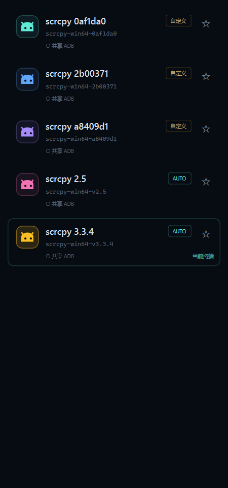
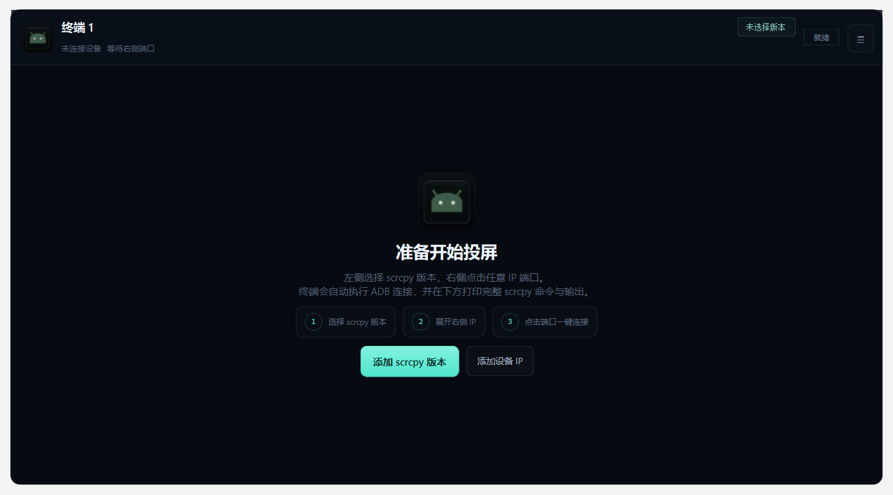

# Scrcpy Dock

Windows 桌面端 **scrcpy 多版本、多设备、多终端**管理工具。

三栏布局：左侧管理 scrcpy 版本，中间运行多个终端，右侧按 IP 管理 ADB / Docker 端口。左右两栏只作用于当前显示的终端。


## 功能

### 版本与设备

- 自动执行 `scrcpy --version` 识别版本。
- 单个添加或批量扫描父文件夹中的多个 scrcpy 版本。
- 版本标签可自定义，也可恢复自动识别。
- 收藏版本，收藏项置顶。
- 版本卡片使用彩色 Android 头像标识，右键可修改预设色或自定义颜色。
- 自动导入 ADB 已连接的无线设备。
- 自动合并本机 `docker ps` 中发布到 5555–5585 的 Android / ADB 端口，适合 redroid。
- 每个 IP 支持 **全端口扫描 1–65535**，也提供常用范围快速扫描。
- 全端口扫描使用 ADB CNXN 握手过滤 SMB、RPC、Web 等普通服务，只保留可用 adbd 端口。
- IP 端口分组可以随时展开/收起，已连接的 IP 不会被强制展开。

### 连接与终端

- 点击端口一键执行：
  1. `adb connect IP:端口`
  2. `scrcpy -s IP:端口`
- 以所选 scrcpy 目录作为工作目录，优先使用该版本自带的 `adb.exe` 和 `scrcpy.exe`。
- 兼容 scrcpy 1.19 / 1.24 等旧版本，不向旧版本传 `--adb`。
- scrcpy 仍使用自己的原生投屏窗口；Scrcpy Dock 负责进程、命令、日志和多终端管理。
- scrcpy 原生窗口标题为 `IP:端口 设备名`。
- 多个终端并行运行，页签显示版本和 `IP:端口`。
- 终端输出实时滚动、自动写日志，并支持停止、重连、清空和复制命令。
- 中央终端底部可直接输入命令：
  - `Enter`：运行
  - `↑ / ↓`：命令历史
  - `Ctrl+C`：终止当前命令或投屏进程
  - `Ctrl+Shift+C`：复制选中文本
  - `Ctrl+V` / `Shift+Insert`：粘贴
  - `Ctrl+L`：清屏
  - `cd`：切换并保持工作目录

### 应用

- 主窗口标题固定为 `Scrcpy Dock`。
- 左栏底部 “关于 Scrcpy Dock” 或 `F1` 打开版本信息页，可查看软件版本、构建时间、Qt / PySide6 / Python、系统、ADB、数据路径和运行统计，并复制诊断信息。
- 退出时统一结束 scrcpy 进程树和未完成命令，避免残留。

## 界面

左侧版本卡片的颜色标识：



终端页头与空闲页图标：



## 下载

发布后从 GitHub **Releases** 下载 Windows 免安装包：

```text
ScrcpyDock-v1.2.5-win64.zip
```

解压后运行 `ScrcpyDock.exe`。仓库源码中不提交打包产物。

> 本项目不包含 scrcpy 和 Android platform-tools 二进制，需要自行准备至少一个 scrcpy 版本文件夹。

## 从源码运行

要求 **Python 3.11+**，开发环境为 Python 3.12 + PySide6 6.8.3。

```powershell
python -m pip install -r requirements.txt
python run.py
```

## 使用流程

1. 点击左栏右上角 `＋`，选择包含 `scrcpy.exe` 的完整版本文件夹；也可以用齿轮菜单批量扫描父文件夹。
2. 点击版本卡片，把它设为当前终端使用的 scrcpy。
3. 右栏会自动导入已连接的无线 ADB 设备；也可以手动添加 IP。
4. 展开 IP，点击端口即可连接当前终端。
   - **全端口**：扫描 1–65535，适合查找远端 Docker 容器的随机映射端口。
   - **快速**：只扫描设置中的常用范围。
   - 默认添加 IP 后执行全端口扫描，可在“IP 与 ADB 设置”中关闭。
5. 中间顶部 `＋` 新建更多终端；切换页签后，左右栏自动作用于新的当前终端。

### 右键菜单

- 左栏空白处：添加版本、批量扫描、重新检测全部、版本设置、关于。
- 版本项：切换版本、收藏、修改标签、图标颜色、重新检测、打开文件夹、移除。
- 右栏空白处：添加 IP、刷新 ADB 设备、IP 设置、关于。
- IP 项：连接、编辑、全端口/快速扫描、添加端口、复制、移除。
- 端口项：连接、复制 `IP:端口`、移除。
- 终端页签：关闭、清空、复制命令、停止 / 重连。

### 快捷键

| 快捷键 | 功能 |
| --- | --- |
| `Ctrl+N` | 新建终端 |
| `Ctrl+Tab` / `Ctrl+Shift+Tab` | 下一个 / 上一个终端 |
| `Ctrl+,` | IP 与 ADB 设置 |
| `F1` | 关于 / 版本信息 |
| `Ctrl+C` | 中断命令或投屏 |
| `Ctrl+Shift+C` | 复制终端选中文本 |
| `Ctrl+V` | 粘贴命令 |
| `Ctrl+L` | 清屏 |

## 数据位置

默认保存在：

```text
%LOCALAPPDATA%\ScrcpyDock\
├─ config.json   # 版本、收藏、IP、端口、设置
└─ logs\         # 每个终端的日志 + app.log
```

可通过环境变量 `SCRCPY_DOCK_DATA_DIR` 指定其他目录。

## 开发与测试

```powershell
python -m pip install -r requirements.txt
python -m unittest discover -s tests -v
```

目录结构：

```text
app/
├─ config.py                 # 配置与持久化
├─ parsers.py                # ADB / 参数 / 版本纯函数
├─ services/
│  ├─ adb.py                 # ADB 发现与设备列表
│  ├─ docker_ports.py        # docker ps 发布端口
│  ├─ scanner.py             # TCP 端口扫描 + ADB 握手
│  ├─ terminals.py           # QProcess 终端与命令执行
│  ├─ tools.py               # scrcpy 版本发现
│  └─ window_title.py        # Win32 scrcpy 窗口标题
└─ ui/
   ├─ main_window.py         # 三栏主界面
   ├─ console.py             # 终端输出与输入
   ├─ rails.py               # 左右栏卡片
   ├─ tabs.py                # 多行终端页签
   ├─ dialogs.py             # 设置、关于等对话框
   ├─ resources.py           # 应用图标加载
   └─ theme.py               # Qt 样式表
```

## 打包

安装打包依赖：

```powershell
python -m pip install -r requirements.txt -r requirements-build.txt
```

执行：

```powershell
powershell -ExecutionPolicy Bypass -File .\build.ps1
```

生成：

```text
release\ScrcpyDock\ScrcpyDock.exe
```

当前使用 PyInstaller 的 `--onedir --windowed` 免安装目录形式。需要安装包时可在该产物上追加 NSIS / Inno Setup。

## 已知边界

- scrcpy 画面是 scrcpy 的原生窗口，不会嵌入 Qt 窗口。
- 中央终端是命令执行式终端，不是完整 PTY；`adb shell` 等持续交互命令可启动，但输入交互需中断后重新执行。
- 远端 Docker 主机未开放 Docker API 时，使用该 IP 的全端口扫描发现端口。
- 全端口扫描通常需要几十秒，扫描结果受网络、防火墙和目标设备响应速度影响。

## 许可证

MIT License，详见 [LICENSE](LICENSE)。

## 致谢

- [Genymobile/scrcpy](https://github.com/Genymobile/scrcpy)
- [Android platform-tools](https://developer.android.com/tools/releases/platform-tools)
- [Qt for Python / PySide6](https://doc.qt.io/qtforpython/)
